<!-- Profile README for the PUBLIC repo Elverovski/Elverovski. Animated SVGs live in assets/ (generated by github-profile/tools/build-assets.mjs). -->

<picture>
  <source media="(prefers-color-scheme: dark)" srcset="assets/header-dark.svg">
  
</picture>

  

<a href="https://elverovski.com/"><picture><source media="(prefers-color-scheme: dark)" srcset="assets/btn-portfolio-dark.svg"></picture></a>&nbsp;
<a href="mailto:contact@elverovski.com"><picture><source media="(prefers-color-scheme: dark)" srcset="assets/btn-email-dark.svg"></picture></a>&nbsp;
<a href="https://x.com/elverovski"><picture><source media="(prefers-color-scheme: dark)" srcset="assets/btn-x-dark.svg"></picture></a>

 

<i>Building modern applications with clean, scalable code and a passion for creating exceptional digital experiences.</i>

 

<picture>
  <source media="(prefers-color-scheme: dark)" srcset="assets/terminal-dark.svg">
  
</picture>

 

## Tech stack

<table>
  <tr>
    <td width="150"><b>Core</b></td>
    <td>
      <picture><source media="(prefers-color-scheme: dark)" srcset="https://skillicons.dev/icons?i=java,spring&theme=dark"></picture>
    </td>
  </tr>
  <tr>
    <td><b>Backend</b></td>
    <td>
      <picture><source media="(prefers-color-scheme: dark)" srcset="https://skillicons.dev/icons?i=kotlin,python,fastapi,nodejs,nestjs&theme=dark"></picture>
    </td>
  </tr>
  <tr>
    <td><b>Frontend &amp; mobile</b></td>
    <td>
      <picture><source media="(prefers-color-scheme: dark)" srcset="https://skillicons.dev/icons?i=ts,react,angular,nextjs,tailwind&theme=dark"></picture>
    </td>
  </tr>
  <tr>
    <td><b>Data</b></td>
    <td>
      <picture><source media="(prefers-color-scheme: dark)" srcset="https://skillicons.dev/icons?i=postgres,supabase,mysql,mongodb&theme=dark"></picture>
    </td>
  </tr>
  <tr>
    <td><b>DevOps &amp; tools</b></td>
    <td>
      <picture><source media="(prefers-color-scheme: dark)" srcset="https://skillicons.dev/icons?i=docker,githubactions,aws,postman,git&theme=dark"></picture>
    </td>
  </tr>
  <tr>
    <td><b>Also</b></td>
    <td>
      <picture><source media="(prefers-color-scheme: dark)" srcset="https://skillicons.dev/icons?i=unity,cs,godot,blender,raspberrypi&theme=dark"></picture>
    </td>
  </tr>
</table>

## Featured projects

  <a href="https://github.com/Elverovski/Artify"><picture><source media="(prefers-color-scheme: dark)" srcset="assets/card-artify-dark.svg"></picture></a>
  <a href="https://github.com/Elverovski/System-Scolaire"><picture><source media="(prefers-color-scheme: dark)" srcset="assets/card-systeme-scolaire-dark.svg"></picture></a>
  <a href="https://github.com/Elverovski/projet_box"><picture><source media="(prefers-color-scheme: dark)" srcset="assets/card-box-fight-arena-dark.svg"></picture></a>
  <a href="https://github.com/Elverovski/Dancing-MikuRobot"><picture><source media="(prefers-color-scheme: dark)" srcset="assets/card-dancing-miku-robot-dark.svg"></picture></a>
  <a href="https://github.com/Elverovski/portfolio"><picture><source media="(prefers-color-scheme: dark)" srcset="assets/card-portfolio-dark.svg"></picture></a>
  <a href="https://elverovski.com/"><picture><source media="(prefers-color-scheme: dark)" srcset="assets/card-more-dark.svg"></picture></a>

## Contribution activity

<picture>
  <source media="(prefers-color-scheme: dark)" srcset="https://raw.githubusercontent.com/Elverovski/Elverovski/output/snake-dark.svg">
  
</picture>

 

<picture>
  <source media="(prefers-color-scheme: dark)" srcset="assets/footer-dark.svg">
  
</picture>
