<!-- Profile README for the PUBLIC repo Elverovski/Elverovski. Animated SVGs live in assets/ (generated by github-profile/tools/build-assets.mjs). -->

<picture>
  <source media="(prefers-color-scheme: dark)" srcset="assets/header-dark.svg">
  
</picture>

  

<a href="https://elverovski.com/"><picture><source media="(prefers-color-scheme: dark)" srcset="assets/btn-portfolio-dark.svg"></picture></a>&nbsp;
<a href="mailto:contact@elverovski.com"><picture><source media="(prefers-color-scheme: dark)" srcset="assets/btn-email-dark.svg"></picture></a>&nbsp;
<a href="https://x.com/elverovski"><picture><source media="(prefers-color-scheme: dark)" srcset="assets/btn-x-dark.svg"></picture></a>

 

<i>Building modern applications with clean, scalable code and a passion for creating exceptional digital experiences.</i>

 

<picture>
  <source media="(prefers-color-scheme: dark)" srcset="assets/section-about-dark.svg">
  
</picture>

<picture>
  <source media="(prefers-color-scheme: dark)" srcset="assets/terminal-dark.svg">
  
</picture>

 

<picture>
  <source media="(prefers-color-scheme: dark)" srcset="assets/section-stack-dark.svg">
  
</picture>

<picture>
  <source media="(prefers-color-scheme: dark)" srcset="assets/stack-dark.svg">
  
</picture>

<picture>
  <source media="(prefers-color-scheme: dark)" srcset="assets/section-journey-dark.svg">
  
</picture>

<picture>
  <source media="(prefers-color-scheme: dark)" srcset="assets/timeline-dark.svg">
  
</picture>

 

<picture>
  <source media="(prefers-color-scheme: dark)" srcset="assets/section-projects-dark.svg">
  
</picture>

  <a href="https://github.com/Elverovski/Artify"><picture><source media="(prefers-color-scheme: dark)" srcset="assets/card-artify-dark.svg"></picture></a>
  <a href="https://github.com/Elverovski/System-Scolaire"><picture><source media="(prefers-color-scheme: dark)" srcset="assets/card-systeme-scolaire-dark.svg"></picture></a>
  <a href="https://github.com/Elverovski/projet_box"><picture><source media="(prefers-color-scheme: dark)" srcset="assets/card-box-fight-arena-dark.svg"></picture></a>
  <a href="https://github.com/Elverovski/Dancing-MikuRobot"><picture><source media="(prefers-color-scheme: dark)" srcset="assets/card-dancing-miku-robot-dark.svg"></picture></a>
  <a href="https://github.com/Elverovski/portfolio"><picture><source media="(prefers-color-scheme: dark)" srcset="assets/card-portfolio-dark.svg"></picture></a>
  <a href="https://elverovski.com/"><picture><source media="(prefers-color-scheme: dark)" srcset="assets/card-more-dark.svg"></picture></a>

<picture>
  <source media="(prefers-color-scheme: dark)" srcset="assets/section-activity-dark.svg">
  
</picture>

<picture>
  <source media="(prefers-color-scheme: dark)" srcset="https://raw.githubusercontent.com/Elverovski/Elverovski/output/stats-dark.svg">
  
</picture>

  

<picture>
  <source media="(prefers-color-scheme: dark)" srcset="https://raw.githubusercontent.com/Elverovski/Elverovski/output/snake-dark.svg">
  
</picture>

 

<picture>
  <source media="(prefers-color-scheme: dark)" srcset="assets/footer-dark.svg">
  
</picture>
